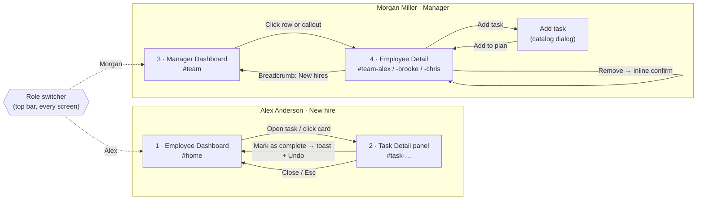

# YFP (Your First Path): User Flow and Screen Flow

Companion to `01-pm-brief.md`. This doc covers how the prototype works (UX). Visual direction is in `03-design-notes.md`.

---

## 1. What the prototype proves

One end-to-end workflow, straight from the brief:

> Employee views dashboard → completes a task → progress updates → switch to manager → manager dashboard shows the update.

Everything else in the prototype supports that loop or the MVP success criteria. If a feature didn't help either one, it was left out.

---

## 2. Demo setup

The prototype runs on a fixed **demo date: Friday, Oct 30, 2026**, so it behaves the same every time it is shown. All data is mock data and stays in the browser. **Reset demo** in the top bar restores the starting state.

| Persona | Role | Start date | Situation on demo date | Status |
|---|---|---|---|---|
| **Alex Anderson** (primary) | Associate Product Manager | Mon, Nov 2 | Pre-boarding, 3 days before Day 1. 2 of 11 tasks done (18%). Post-D1 tasks locked. | On track |
| **Morgan Miller** (secondary) | Hiring manager, Product | — | Manages Alex, Brooke and Chris (all on the Product team) | — |
| Brooke Bennett | Product Designer | Fri, Oct 30 | **Day 1.** All Pre-D1 tasks done; orientation and laptop setup due today. 55%. | On track |
| Chris Carter | Product Manager II | Mon, Oct 26 | **Day 5.** 2 Post-D1 tasks overdue. 67%. | **Needs support** |

Why Chris has the *highest* progress but needs support: this is deliberate. It shows that a percentage alone hides risk. Status is driven by overdue work, not by how much is done.

---

## 3. Primary demo script (about 2 minutes)

| # | Persona | Screen | Action | What the audience should notice |
|---|---|---|---|---|
| 1 | Alex | Employee Dashboard | Land on the page | One place for everything. "Next up" says what to do now. Progress is 18%; Pre-D1 is 2/6 with "3 days left". Post-D1 work is visibly locked. |
| 2 | Alex | Task Detail | Click **Open task** on *Complete I-9 and tax forms* | Clear steps, who assigned it, and when it is due. A single primary action. |
| 3 | Alex | Task Detail → Dashboard | Click **Mark as complete** | Panel closes, card moves to **Done** with a "Just completed" tag, ring goes 18% → 27%, toast confirms with **Undo**. "Next up" advances to *Set up direct deposit*. |
| 4 | — | Role switcher | Click **Morgan Miller** | One click, no login. |
| 5 | Morgan | Manager Dashboard | Look at Alex's row | Alex is now 27% with "Just now · Completed 'Complete I-9 and tax forms'". Team average 47% → 50%. |
| 6 | Morgan | Manager Dashboard | Read the red callout | Chris needs support (2 overdue). Rows are sorted so people needing attention come first. |
| 7 | Morgan | Employee Detail | Click **Review Chris's plan** or Alex's row | Full plan grouped Pre-D1 / Post-D1 with per-task status. |
| 8 | Morgan | Employee Detail | **Add task** → pick from catalog → set due date → add | Task appears with a "Just added" tag. Switching back to Alex shows it on her board right away. |
| 9 | Morgan | Employee Detail | Trash icon → confirm **Remove task** | Inline confirmation, then toast with **Undo**. |

---

## 4. Screen flow

Every view has its own URL hash (`#home`, `#task-alex-i9`, `#team`, `#team-chris`), so the browser back button works and any screen can be opened directly from a link during a demo.

---

## 5. Screens

### 5.1 Employee Dashboard (Alex)
**Job:** tell the new hire what to do next and how far along they are.

Information order, top to bottom:
1. **Greeting + Day 1 context.** "Your Day 1 is Monday, November 2. Finish your Pre-D1 tasks before then."
2. **Summary panel**, in three parts:
   - *Overall progress*: ring + "2 of 11 tasks done" + on-track/overdue line.
   - *Pre-D1 vs Post-D1 meters*: covers the success criterion about telling before-Day-1 work from after-Day-1 work. Pre-D1 shows the deadline ("Finish by Sun, Nov 1 · 3 days left"); Post-D1 shows "Locked until Mon, Nov 2".
   - *Next up*: the single most urgent open task, with an **Open task** button.
3. **Board**: **Do today · Do later · Done**, each with a count and a one-line rule.

### 5.2 Task Detail (side panel)
**Job:** give the new hire everything needed to finish one task, plus one clear action.

- Tags (timing + type), title, due date (with "due today" / "overdue by N days"), who assigned it, type.
- "About this task", then "How to complete it": a **resource link** to the source (e.g. the Welcome video on internal comms, the HR forms portal, the training course), followed by numbered steps that refer to it. Every task has exactly one link, shown as a prominent green card with its source system and address.
- In the prototype the links are clickable but go nowhere: clicking shows a toast naming the internal page it would open (e.g. `comms.brightpath.com/videos/welcome-to-brightpath`). For locked Post-D1 tasks the link is greyed out and can't be clicked until Day 1.
- Primary action: **Mark as complete** (or **Mark as reviewed** for Review tasks).
- Completed tasks show **Mark as not done** instead, so a new hire can correct a task marked done by mistake after the Undo toast is gone.
- Opens as a panel over the dashboard so the board stays in view. Closing returns the user to exactly where they were.

### 5.3 Manager Dashboard (Morgan)
**Job:** answer "is onboarding on track, and who needs me?" in under 5 seconds.

1. **Three tiles:** Need support (count + names), Average progress, Starting next (who + Pre-D1 tasks left).
2. **Attention callout** for each person needing support, naming the overdue task and linking to their plan.
3. **Progress table**, sorted *needs support first*, then by start date. Columns: New hire · Stage (Day N / Starts date) · Progress · Next due · Status · Latest activity.
4. **Latest activity** shows "Just now" in green when the employee completed something this session. This is how the manager sees updates the moment they happen.

### 5.4 Employee Detail (Morgan → one hire)
**Job:** inspect one person's plan and adjust it.

- Header: identity, stage, status pill, progress bar, overdue count, **Add task**.
- Plan table grouped **Before Day 1 (Pre-D1)** and **From Day 1 (Post-D1)**, each with an "x/y done" count.
- Per task: due date, status (Done / Overdue / Due today / Due tomorrow / Upcoming / Locked until Day 1), added by, action.
- **Add task** opens the catalog dialog. Available items are listed first. Each item shows its tags and a one-line description. Due date is pre-filled from the item's default offset to the start date, or the demo date + 2 days if that date has already passed, and can be edited.
- **Remove** uses an inline confirmation row (no pop-up dialog), then a toast with **Undo**.

### 5.5 States covered

| State | Where | Behavior |
|---|---|---|
| Empty bucket | Employee board | Dashed placeholder explaining what will appear ("Nothing due right now"). |
| All caught up | Next up card | "You're all caught up" + how many tasks unlock on Day 1. |
| Locked (Post-D1, pre-start) | Board, Task Detail, Employee Detail | Listed under "Unlocks on Day 1 · Mon, Nov 2". The panel opens read-only with a disabled "Available on Mon, Nov 2" button. The resource link is greyed out and can't be clicked; its label and address are hidden and replaced by "Link available on Mon, Nov 2". |
| Overdue | Board card, panel, manager table | Red "Overdue by N days". Panel suggests reaching out to the manager. Employee status becomes **Needs support**. |
| Just completed | Board card, manager table | "Just completed" tag on the card; "Just now" in the manager's activity column. |
| Pending confirmation | Employee Detail | Inline remove confirmation row. |
| Catalog item unavailable | Add task dialog | Disabled with reason: "Already in Alex's plan" or "Pre-D1 tasks can't be added after the start date". |
| Catalog exhausted | Add task dialog | Empty state: "Every catalog task is already in Alex's plan." |
| Nothing addable | Add task dialog | When the only items left are Pre-D1 and the hire has started: "No catalog tasks can be added for Chris right now." |
| Task removed while open | Task Detail | "This task isn't in your plan" with a way back. |
| Bad link / unknown page | Any | Friendly not-found screen with a button to a valid screen. |
| Undo | Complete, remove | Toast with **Undo** for 7 seconds. |

---

## 6. Rules the prototype applies

**Buckets** (each sorted by nearest due date):

| Bucket | Rule |
|---|---|
| Do today | Not done, unlocked, and overdue, due today, or due tomorrow |
| Do later | Not done and due after tomorrow; plus locked Post-D1 tasks grouped at the bottom |
| Done | Completed |

"Tomorrow" is included in Do today so a task never jumps from "later" to "late" overnight. It gives the new hire a one-day heads-up.

**Locking:** Post-D1 tasks are locked when the demo date is before the employee's start date.

**Progress:** completed tasks ÷ all assigned tasks (locked tasks included, so the number doesn't jump on Day 1).

**Status:**
- **Needs support**: one or more unlocked tasks are past due.
- **On track**: everything else.

**Stage:** "Starts {date}" before Day 1; "Day N" (working days since start, inclusive) after.

**Manager edits:**
- Managers add only from the predefined **catalog** (10 items, e.g. *Review the Team Wiki*, *Read the Employee Handbook*). No custom tasks, per the brief.
- **HR-required** tasks (offer letter, I-9, orientation, laptop…) can't be removed by a manager.
- **Completed** tasks can't be removed, so the record of progress stays intact.
- A task already in the plan can't be added twice. Pre-D1 tasks can't be added after the start date.

**Sync:** employee and manager views read the same in-memory store (also saved to the browser). Any change shows up in the other view immediately.

---

## 7. Interpretation notes and open questions

1. **Seeing vs. locking Post-D1 tasks (decided).** The brief says "Post-D1 tasks remain locked and unavailable until the start date" and "Before Day 1, can only access Pre-D1 tasks." "Access" is read as "act on": Post-D1 tasks are visible and readable in a compact, locked list so new hires know what is coming, but can't be acted on until Day 1. Hiding them entirely is a one-line change if the team prefers it.
2. **"Needs support" definition.** Currently "any overdue task". A real version might also flag inactivity (e.g. no completions in 3+ days) or overdue Pre-D1 tasks close to the start date.
3. **Who owns the catalog.** Assumed HR-curated; managers pick from it. This leaves room for templates later (the HR manager's request) without building them now.
4. **Manager notifications.** Out of scope. Managers see updates when they open the dashboard.

---

## 8. Deliberately out of scope

Authentication, real data/APIs, templates, custom task creation, comments/chat, notifications, analytics, mobile layouts, and any AI features, all per the brief. The role switcher stands in for login.
